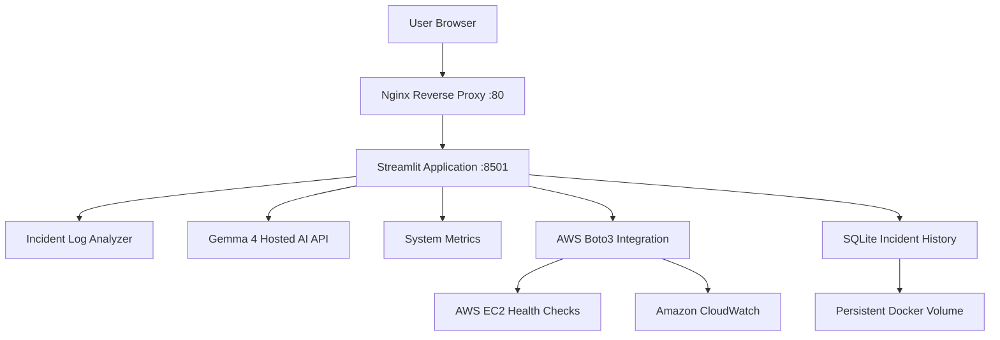

# ☁️ CloudOps Incident Assistant

**AI-powered incident analysis, infrastructure monitoring, and troubleshooting on AWS.**

CloudOps Incident Assistant is a cloud-hosted application that helps investigate infrastructure issues by combining system metrics, AWS health checks, CloudWatch CPU metrics, log analysis, and AI-generated troubleshooting recommendations in one dashboard.

Built for the **Hacktoberfest HackDay Bengaluru × AWS Student Builder Group** at Atria Institute of Technology.

## 📸 Application Screenshots

### 1. Application Overview


### 2. AWS EC2 Health

Displays the EC2 instance state and AWS system and instance status checks.


### 3. Incident Log Analyzer and Gemma 4 AI

Analyze application or infrastructure error logs and request AI-assisted troubleshooting recommendations.


### 4. System Metrics and Incident History

Monitor CPU, memory, and disk utilization, review configured alert thresholds, and view saved incident records.


### 5. AWS CloudWatch CPU Metrics

View historical EC2 CPU utilization using CloudWatch datapoints.


## ✨ Key Features

- **AI-powered analysis:** Uses a hosted Gemma 4 model to help explain incidents and recommend troubleshooting steps.
- **Incident log analyzer:** Accepts application and infrastructure error logs for analysis.
- **System monitoring:** Displays CPU, memory, and disk usage.
- **Configurable thresholds:** Set CPU, memory, and disk alert thresholds.
- **Application health check:** Check an application URL from the dashboard.
- **AWS EC2 health:** Retrieve instance state and AWS status checks.
- **CloudWatch integration:** Retrieve historical EC2 CPU utilization.
- **Incident history:** Persist incident records using SQLite.
- **Docker deployment:** Run the application in a container behind Nginx.
- **Human-reviewed recommendations:** AI output is advisory; remediation is not automatic.

## 🏗️ Architecture



### How it works

1. A user opens the dashboard through the Nginx HTTP endpoint.
2. Streamlit presents system metrics, incident analysis, and AWS monitoring features.
3. The log analyzer helps identify potential infrastructure or application problems.
4. Gemma 4 provides AI-assisted explanations and recommended next steps.
5. Boto3 retrieves EC2 health information and CloudWatch CPU metrics.
6. SQLite saves incident records in persistent storage.

## 🛠️ Technology Stack

| Category | Technologies |
|---|---|
| Cloud | AWS EC2 |
| Monitoring | Amazon CloudWatch |
| AWS SDK | Boto3 |
| Application | Python, Streamlit |
| AI | Google Gen AI SDK, hosted Gemma 4 |
| System metrics | psutil |
| Database | SQLite |
| Containerization | Docker |
| Reverse proxy | Nginx |
| Version control | Git, GitHub |

## ☁️ AWS Integration

### Amazon EC2
Hosts the application on an Ubuntu instance.

### Amazon CloudWatch
Provides historical EC2 CPU utilization metrics for troubleshooting and monitoring.

### AWS IAM
The application uses an EC2 instance role with permissions for the required read-only EC2 and CloudWatch operations rather than embedding AWS access keys in the source code.

## 🔎 Incident Scenarios Tested

| Simulated scenario | Investigation goal |
|---|---|
| High CPU and application latency | Identify possible resource bottlenecks |
| Database connection timeout | Investigate connectivity and database availability |
| Disk-space exhaustion | Identify storage pressure and possible cleanup actions |

These scenarios were tested using simulated logs. They should not be interpreted as actual production outages.

## 💾 Persistent Incident History

Incident records are stored in SQLite at:

```text
/data/incidents.db
```

The database directory is mounted to a Docker named volume:

```bash
-v cloudops_incident_data:/data
```

This allows saved records to remain available when the application container is restarted or recreated, provided the volume is retained.

**Validation:** Four existing incident records remained available after a container restart during testing.

## 🚀 Deployment

### Prerequisites

- An Ubuntu/Linux environment or an AWS EC2 instance
- Docker installed
- A Google AI API key for AI-powered analysis
- An EC2 instance role with the required AWS read permissions

### 1. Clone the repository

```bash
git clone https://github.com/Suraj-dot-wq/CloudOps-Incident-Assistant.git
cd CloudOps-Incident-Assistant
```

### 2. Configure environment variables

Create a local `.env` file using the variable names expected by the application:

```env
GOOGLE_API_KEY=your_google_ai_api_key
GEMINI_MODEL=gemma-4-26b-a4b-it
```

Do not commit `.env` or share your API key. If your application uses a different model variable name, use the name configured in your source code.

### 3. Build the Docker image

```bash
docker build -t cloudops-incident-assistant:1.8 .
```

### 4. Create persistent storage

```bash
docker volume create cloudops_incident_data
```

### 5. Run the container

```bash
docker run -d \
  --name cloudops-assistant \
  --restart unless-stopped \
  --env-file .env \
  -e AWS_REGION=ap-south-1 \
  -e EC2_INSTANCE_ID=YOUR_EC2_INSTANCE_ID \
  -p 127.0.0.1:8501:8501 \
  -v cloudops_incident_data:/data \
  cloudops-incident-assistant:1.8
```

Configure Nginx to proxy requests to `127.0.0.1:8501` if you want to access the application through the host's HTTP endpoint.

> The command above describes a fresh deployment. On the existing server, avoid running it with the same container name until you have checked the current deployment.

## 🔐 Security Considerations

- Keep API keys in environment variables, not in source code.
- Use IAM roles and least-privilege permissions for AWS access.
- Sanitize logs before sending them to an external AI service.
- Treat AI-generated explanations as recommendations, not verified root causes.
- Review actions before performing remediation.
- Configure HTTPS, authentication, and appropriate network restrictions before exposing the application to broader public use.

## 🧪 Testing and Validation

- Verified the dashboard's HTTP response through the local Nginx endpoint.
- Tested simulated incident log scenarios.
- Tested AI-generated troubleshooting recommendations.
- Verified EC2 health and CloudWatch metric integration.
- Confirmed incident history persisted across a container restart.
- Checked that `.env` and backup files are excluded from Git.

## 💰 Cost-Conscious Design

The application uses an existing EC2 instance, Docker, SQLite, and AWS APIs rather than requiring a separate database server.

Costs may still arise from EC2 compute, storage, CloudWatch usage, and the external AI provider. Monitor AWS usage and provider pricing.

## 🔮 Future Improvements

- Add authentication and role-based access control.
- Add alert notifications for selected incident conditions.
- Improve evidence-based severity classification.
- Support structured log ingestion and filtering.
- Expand AWS service health checks.
- Introduce optional human-approved remediation workflows.
- Add automated tests and CI/CD deployment.

## 🎯 Project Goal

Simplify initial cloud incident investigation by bringing infrastructure metrics, AWS health checks, log analysis, AI-assisted troubleshooting, and persistent incident history into a single dashboard.

## 👨‍💻 Author

**Suraj Ghadage**

- GitHub: [Suraj-dot-wq](https://github.com/Suraj-dot-wq)
- Project: [CloudOps Incident Assistant](https://github.com/Suraj-dot-wq/CloudOps-Incident-Assistant)

---

*Built as a hands-on project exploring AWS monitoring, AI-assisted incident troubleshooting, Docker, and persistent application data.*
